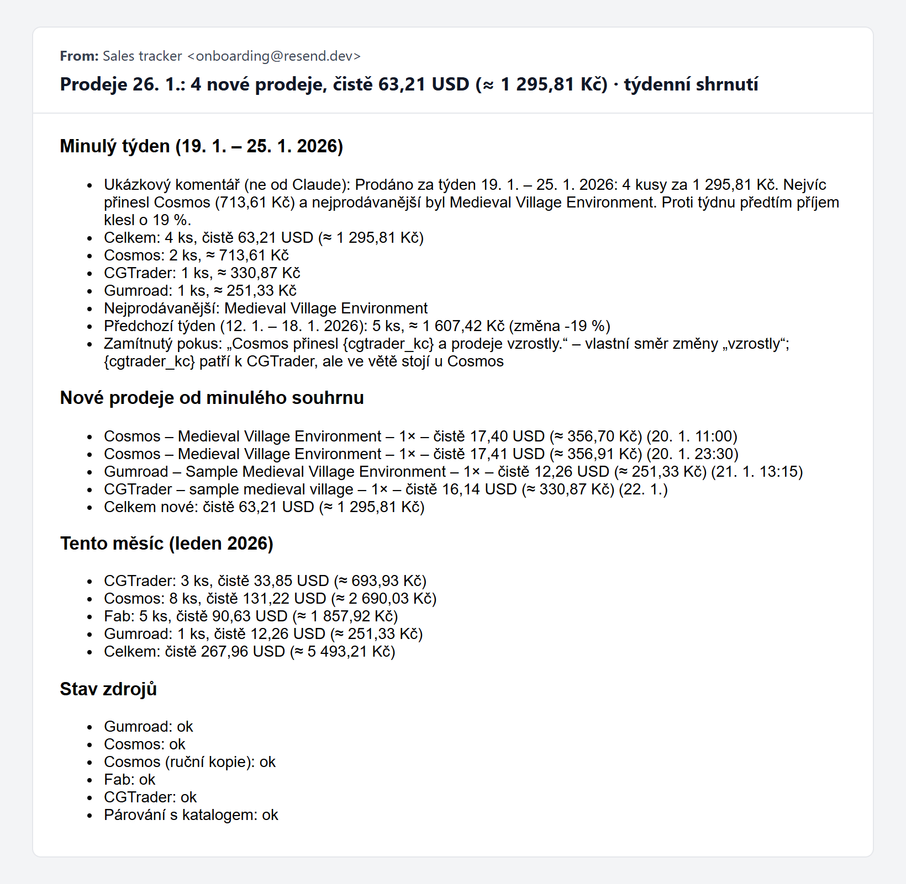
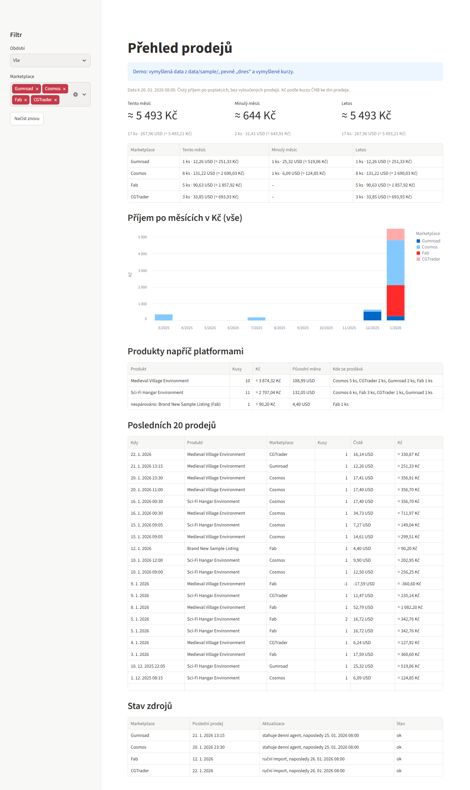
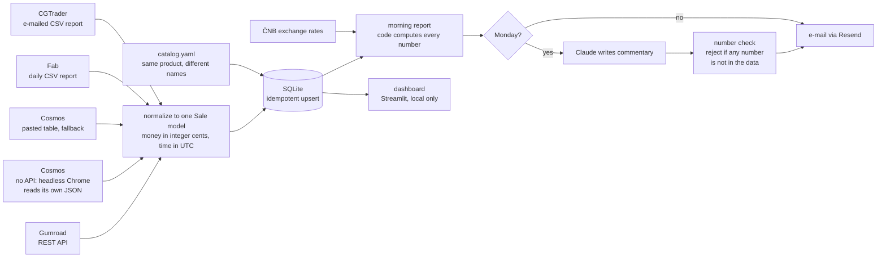

# marketplace-sales-tracker

[](https://github.com/vitekchalanyenv/marketplace-sales-tracker/actions/workflows/ci.yml)

**One morning e-mail with every sale from four marketplaces.** A real tool I use for the 3D game environments I sell
on **Gumroad, Fab, CGTrader and Cosmos (Leartes)** — each of them exposes sales in a completely different way.

Every morning at 8:00 it pulls sales from all four, stores them in one local database, matches the same product
across platforms, converts totals to CZK at the Czech National Bank rate and e-mails a summary. The sources I upload
by hand (Fab, CGTrader) are watched too: the e-mail says how far their reports reach and warns when one is missing.
The first e-mail of a month adds a monthly summary (numbers only). On Mondays Claude adds
a short commentary on the past week — and **a deterministic check rejects it if it contains a single number that is
not in the data**.



*The Monday morning e-mail, rendered by `demo` from made-up data. The commentary is Claude's real output for this week
(stored so the demo runs offline), checked and filled in by code.*

## Try it in a minute

No accounts, no network, no `.env` — the whole pipeline on the synthetic data in [`data/sample/`](data/sample/):

```powershell
uv sync
uv run python -m sales_tracker demo
uv run python -m sales_tracker demo --dashboard   # ...and open the dashboard on the same data
```

## The dashboard

The e-mail says *what is new*; the dashboard says *where I stand*. A local Streamlit page over the same database:
this month / last month / this year, income per month by marketplace, every product across all platforms (this is
where the catalog matching pays off) and the latest sales, filtered by period and marketplace. Amounts are shown in
the original currency and in CZK; a CZK total with a missing rate is never shown as if it were complete. It listens
on `127.0.0.1` only, with Streamlit's usage statistics off, and all numbers come from one tested module
([`overview.py`](src/sales_tracker/overview.py)) that agrees with the e-mail to the cent.



## How it works



| Marketplace | How the sales get in |
|---|---|
| Gumroad | REST API, paged, last 30 days re-read so refunds are picked up |
| Cosmos | No public API. A dedicated Chrome profile (I log in myself, there is a reCAPTCHA) opens the sales page headless and captures the JSON the page loads for itself. A pasted copy of the table works as a fallback. |
| Fab | Daily sales CSV downloaded by hand; refunds are separate negative rows |
| CGTrader | Sales report CSV sent by e-mail (API access requested); buyer and country are dropped on import |

**Things that are easy to get wrong and are handled:** the same sale imported twice (key = marketplace + transaction
ID), a refund arriving weeks later, a payout per order split across products to the cent, local time vs UTC across
DST, a seller's share that changes month to month, a product called differently on every platform (matched only
exactly — similar names are suggestions, never automatic), and my own test purchase (`exclude`, it stays in the
database but out of every total).

## Claude with a safety net

The Monday commentary is the one place an LLM is in the loop, so it is built to fail safe: **Claude never writes a
number, an order or a cause.**

1. Code computes every number and turns it into named placeholders: `{cosmos_kc}` = "713,61 Kč",
   `{smer_prijmu}` = "klesl" (fell).
2. Claude writes 2–4 sentences with placeholders only (`claude-opus-5-5`, low effort).
3. A deterministic check rejects any digit, number or quantity word, its own direction or ranking, a cause, an
   unknown placeholder, or a value standing next to the wrong name.
4. Code fills in the values. One retry; if it fails again, the e-mail goes out with the code's numbers only.

```text
Cosmos přinesl {cgtrader_kc} a prodeje vzrostly.
→ rejected: own direction "vzrostly"; {cgtrader_kc} belongs to CGTrader but stands next to Cosmos
```

Measured on the real model (20 runs per prompt version): 20 of 20 passed on the first try. The eval exposed a content
problem instead (Claude restated every number), which prompt v2 fixed. The full story — the first version that failed
review, the eval, what the check does not catch and why there is no LLM judge — is in a one-page write-up:
**[Letting an LLM comment on money without letting it make up numbers](docs/writeup.md)**.

## What the AI got wrong (and why it didn't ship)

All code here was written by an AI coding agent (Claude Code) under my review. Every caught mistake is logged in
[`docs/AI_CHYBY.md`](docs/AI_CHYBY.md) (Czech). The most instructive ones:

- **"Cosmos has no API" — wrong.** The agent watched requests to the site's domain only; the API lived on a
  different subdomain.
- **Real data leaking into a public repo, repeatedly** (slugs, an ID, real amounts in "made-up" examples). Fixed
  systematically: a script scanning every version of every file in the history, then a history rewrite.
- **A test that tested nothing.** It would have passed with the opposite rule too. Caught by reading it, not running it.
- **A number check that looked thorough and wasn't.** An independent review fooled it in minutes ("rose 19 %" when
  it fell). Fixed by taking the numbers away from the model entirely.
- **A first-run bug that would silently drop sales**, caught by a test written from the spec before the feature ran.

## Privacy

Real sales never leave my machine: the database, reports and logs live in git-ignored `data/private/`. The repository
holds only synthetic data. Secrets are in `.env` (see [`.env.example`](.env.example)) and the agent never sees them.

## More

- [`docs/USAGE.md`](docs/USAGE.md) — every command: syncing each marketplace, the daily agent, the catalog.
- [`docs/spec/`](docs/spec/) — a spec for every milestone, [`docs/PROGRESS.md`](docs/PROGRESS.md) — progress
  (internal docs are in Czech).
