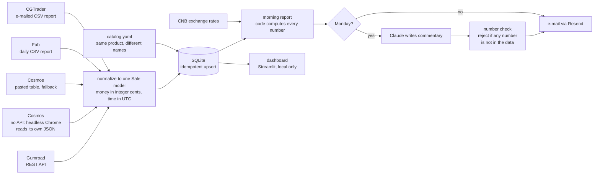

# marketplace-sales-tracker

[](https://github.com/vitekchalanyenv/marketplace-sales-tracker/actions/workflows/ci.yml)

**One morning e-mail with every sale from four marketplaces.** A real tool I use for the 3D game environments I sell
on **Gumroad, Fab, CGTrader and Cosmos (Leartes)** — each of them exposes sales in a completely different way.

Every morning at 8:00 it pulls sales from all four, stores them in one local database, matches the same product
across platforms, converts totals to CZK at the Czech National Bank rate and e-mails a summary. The sources I upload
by hand (Fab, CGTrader) are watched too: the e-mail says how far their reports reach and warns when one is missing.
The first e-mail of a month adds a monthly summary (numbers only). On Mondays Claude adds
a short commentary on the past week — and **a deterministic check rejects it if it contains a single number that is
not in the data**.


*The Monday morning e-mail, rendered by `demo` from made-up data. The commentary is Claude's real output for this week
(stored so the demo runs offline), checked and filled in by code.*

## Try it in a minute

No accounts, no network, no `.env` — the whole pipeline on the synthetic data in [`data/sample/`](data/sample/):

```powershell
uv sync
uv run python -m sales_tracker demo
uv run python -m sales_tracker demo --dashboard   # ...and open the dashboard on the same data
```

## The dashboard

The e-mail says *what is new*; the dashboard says *where I stand*. A local Streamlit page over the same database:
this month / last month / this year, income per month by marketplace, every product across all platforms (this is
where the catalog matching pays off) and the latest sales, filtered by period and marketplace. Amounts are shown in
the original currency and in CZK; a CZK total with a missing rate is never shown as if it were complete. It listens
on `127.0.0.1` only, with Streamlit's usage statistics off, and all numbers come from one tested module
([`overview.py`](src/sales_tracker/overview.py)) that agrees with the e-mail to the cent.


## How it works



| Marketplace | How the sales get in |
|---|---|
| Gumroad | REST API, paged, last 30 days re-read so refunds are picked up |
| Cosmos | No public API. A dedicated Chrome profile (I log in myself, there is a reCAPTCHA) opens the sales page headless and captures the JSON the page loads for itself. A pasted copy of the table works as a fallback. |
| Fab | Daily sales CSV downloaded by hand; refunds are separate negative rows |
| CGTrader | Sales report CSV sent by e-mail (API access requested); buyer and country are dropped on import |

**Things that are easy to get wrong and are handled:** the same sale imported twice (key = marketplace + transaction
ID), a refund arriving weeks later, a payout per order split across products to the cent, local time vs UTC across
DST, a seller's share that changes month to month, a product called differently on every platform (matched only
exactly — similar names are suggestions, never automatic), and my own test purchase (`exclude`, it stays in the
database but out of every total).

## Claude with a safety net

The weekly commentary is the one place an LLM is in the loop, so it is built to fail safe. **Claude never writes a
number, an order or a cause.** The full story, including the first version that failed review, is in a one-page
write-up: [Letting an LLM comment on money without letting it make up numbers](docs/writeup.md).

1. **Code computes every number** for last week (by marketplace, by product, vs the week before, in CZK) and turns
   it into named placeholders: `{cosmos_kc}` = "713,61 Kč", `{smer_prijmu}` = "klesl" (fell), `{zmena_procent}` =
   "19 %", `{nejlepsi_marketplace}` = the channel with the highest income…
2. **Claude writes 2–4 sentences with placeholders only** (`claude-opus-5-5`, low effort), e.g.
   *"Hlavním kanálem byl {nejlepsi_marketplace} s příjmem {cosmos_kc}. Proti týdnu předtím příjem {smer_prijmu}
   o {zmena_procent}."*
3. **A deterministic check** rejects the text if it contains
   - any digit, Czech number word or quantity word — *jediný, oba, několik, většina, pár*… (even a correct number can
     be attached to the wrong thing),
   - its own direction — *rose, fell, more, better*… (direction comes only from `{smer_prijmu}`, computed by code),
   - its own ranking — any superlative, *nejlépe, nejsilnější*… (order comes only from `{nejlepsi_marketplace}` and
     `{nejprodavanejsi_produkt}`; a positive superlative is allowed only in the same sentence as one of them, so
     *"Nejvíc přinesl {nejlepsi_marketplace}"* passes and *"Nejméně přinesl {nejlepsi_marketplace}"* does not),
   - a cause — *kvůli, díky, protože*… (the data has no causes),
   - a product name written out instead of its placeholder, or a placeholder that does not exist,
   - a marketplace or product value next to the wrong name: the nearest name *before* the placeholder in the same
     sentence must be the one the value belongs to.
4. **The code fills in the values.** One retry with the problems named; if it fails again, the e-mail goes out
   **with the code's numbers only** and the rejected text goes to the log.

From the demo — the first attempt was wrong on purpose:

```text
Cosmos přinesl {cgtrader_kc} a prodeje vzrostly.
→ rejected: own direction "vzrostly"; {cgtrader_kc} belongs to CGTrader but stands next to Cosmos
```

**Measured on the real model** ([`scripts/eval_commentary.py`](scripts/eval_commentary.py), 20 runs of
`claude-opus-5-5` on the demo week each, raw outputs in [`docs/eval/`](docs/eval/)):

| Prompt | Passed 1st try | After retry | Gave up | Value placeholders per comment | Sentences | Number-agreement risk |
|---|---|---|---|---|---|---|
| v1: "write 2–4 sentences" | 20 | 0 | 0 | 12.8 | 4 | 17 of 20 |
| v2: "pick one or two things, don't repeat the overview below" | 20 | 0 | 0 | 0.9 | 2 | 0 of 20 |

The strict check never starved the feature. What the first eval exposed was *content*: Claude restated almost every
number already listed below the comment and kept writing "se prodalo {celkem_kusu}" (wrong Czech agreement with
"4 kusy"). v2 of the prompt fixed both — measured, not assumed. Caveat: one week of data, so little variety.

The check itself is tested against an eval set of hand-written good and bad commentaries
([`tests/test_weekly.py`](tests/test_weekly.py)), including every attack from two rounds of independent review:
misplaced real numbers, swapped marketplace and product values, "rose" when it fell, "Gumroad had the only sale,
Cosmos both others", "mostly on Gumroad", "Gumroad was the strongest channel", "fell mainly because of Gumroad".

**What it does not catch.** It is a filter on numbers, order and causes, made of word lists and one positional rule —
not an understanding of meaning. Order and quantity hidden in a verb or an adjective still pass, for example
*"Gumroad dominoval."* (Gumroad dominated), *"Cosmos zaostal."* (Cosmos fell behind) or *"Týden byl rekordní."*
(a record week) — the word list will never be complete. Attribution relies on the name standing before its value. That is why the numbers in the e-mail are always the code's and the commentary is marked
"Komentář od Claude" (Claude's comment).

**Why not a second LLM as a judge?** It would be non-deterministic, cost another call, and could hallucinate in turn.
For two to four sentences, a deterministic check with clearly stated limits is the better trade-off: it either passes
or names exactly what failed, the same way every time, and it is testable.

## What the AI got wrong (and why it didn't ship)

All code here was written by an AI coding agent (Claude Code) under my review. Every mistake that was caught is logged
in [`docs/AI_CHYBY.md`](docs/AI_CHYBY.md) (Czech). The most instructive ones:

- **"Cosmos has no API" — committed as fact, and wrong.** The agent watched the network for requests to the site's
  domain, saw none when paging, and concluded the data was baked into the HTML. The API lived on a different
  subdomain. Caught when the downloaded HTML turned out to contain no sales. Rule since: "doesn't exist" only after
  watching *all* network traffic on a fresh page load.
- **Certificates it had already seen fail.** The Gumroad client used Python's bundled CA certificates although `git`
  had failed minutes earlier on the same antivirus-intercepted HTTPS. Mocked tests could not catch it; the first real
  run did. Fixed by using the OS trust store, with verification still on.
- **Real data leaking into a public repo — repeatedly.** Product slugs, a transaction ID, real amounts in "made-up"
  sample data. Caught partly by an automatic leak check that blocked a commit, partly by me. The fix was systematic:
  a script that scans every version of every file in the git history for every amount, ID and title in the private
  database, then a history rewrite.
- **A test that tested nothing.** "Listing ID beats title" passed — but the sample catalog had no case where the two
  disagree, so it would have passed with the opposite rule too. Caught by reading the test, not by running it.
- **A number check that looked thorough and wasn't.** The first version of the weekly check only verified that every
  number in Claude's text *exists somewhere* in the data. An independent review fooled it in minutes: "sales rose
  19 %" when they fell 19 %, Cosmos and CGTrader counts swapped, the CGTrader amount credited to Cosmos — all passed.
  The README even claimed the eval covered "swapped amounts"; that test case actually used a number not in the data.
  Fixed by taking numbers away from the model entirely (placeholders, direction from code, attribution check) and
  adding the review's attacks to the eval.
- **A first-run bug that would silently drop sales.** The report tracks "new since the last e-mail"; if the very first
  e-mail failed, the baseline was never saved and the next run would have skipped that day's sales. Caught by a test
  written from the spec before the feature ran for real.

## Privacy

Real sales never leave my machine: the database, reports and logs live in git-ignored `data/private/`. The repository
holds only synthetic data. Secrets are in `.env` (see [`.env.example`](.env.example)) and the agent never sees them.

## Usage

```powershell
uv sync
uv run pytest
uv run python -m sales_tracker demo   # whole pipeline on made-up data, no accounts or network
uv run python -m sales_tracker dashboard              # dashboard in the browser (local only), Ctrl+C to stop

# copy .env.example to .env and fill in GUMROAD_ACCESS_TOKEN, then:
uv run python -m sales_tracker sync gumroad                     # first run: everything, then last 30 days
uv run python -m sales_tracker sync gumroad --since 2026-01-01

# Cosmos: browser agent (Playwright + installed Chrome, dedicated profile, headless)
uv run python -m sales_tracker sync cosmos --login              # once: log in yourself in the opened window
uv run python -m sales_tracker sync cosmos
uv run python -m sales_tracker import cosmos                    # fallback: pasted sales table, data/private/cosmos/*.txt

# Fab: save the daily sales report CSV into data/private/fab/, then
uv run python -m sales_tracker import fab                       # every CSV in data/private/fab/
uv run python -m sales_tracker import fab path/to/report.csv

# CGTrader: My Sales → View details → Generate report, save the e-mailed CSV into data/private/cgtrader/, then
uv run python -m sales_tracker import cgtrader                  # every CSV in data/private/cgtrader/

# daily agent: all sources, log in data/private/logs/, morning report e-mail via Resend
# (.env: RESEND_API_KEY, REPORT_EMAIL_TO; ANTHROPIC_API_KEY for the Monday weekly commentary)
uv run python -m sales_tracker run daily
uv run python -m sales_tracker run daily --dry-run                # print the report, send nothing
uv run python -m sales_tracker run daily --dry-run --with-claude  # ...and ask Claude for the weekly commentary
powershell -ExecutionPolicy Bypass -File scripts\install_task.ps1   # Task Scheduler, daily 08:00, catches up after boot
powershell -ExecutionPolicy Bypass -File scripts\uninstall_task.ps1

# leave a sale out of all totals (e.g. your own test purchase); --undo counts it again
uv run python -m sales_tracker exclude gumroad <sale id> --reason "test purchase"

# product catalog (data/private/katalog.yaml, see data/sample/katalog.yaml)
uv run python -m sales_tracker catalog check   # validate + list unmatched sales with ready-to-paste YAML
uv run python -m sales_tracker catalog match   # re-assign every sale to a product

# regenerate the README screenshots from the demo
uv run python scripts/demo_screenshot.py
uv run python scripts/dashboard_screenshot.py
```

Specs for every milestone are in [`docs/spec/`](docs/spec/), progress in [`docs/PROGRESS.md`](docs/PROGRESS.md)
(internal docs are in Czech).
